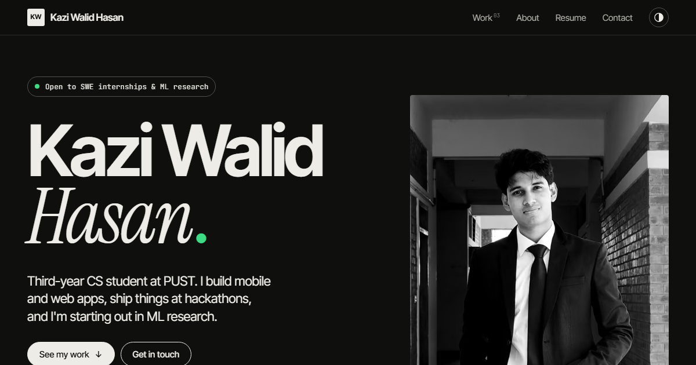

# kaziwalid — personal portfolio

The source for my personal site: who I am, what I've built, and the hackathons I've taken part in.
I'm a third-year Computer Science and Engineering student at PUST, open to SWE internships and ML research.



## Highlights

- **Static and fast.** Built with [Astro](https://astro.build), ships almost no JavaScript, and images are resized and served as AVIF/WebP.
- **Versioned like software.** The version number in the footer is my university semester (`v3.1` = year 3, semester 1), and the homepage changelog tracks milestones by date.
- **One source of content.** Every project, milestone and skill lives in [`src/data/site.ts`](src/data/site.ts). The homepage, project pages, About page and the printable resume are all generated from it, so they can't contradict each other.
- **Printable resume.** `/resume` is an HTML page with print styles; "Save as PDF" turns it into a one-page A4 resume.
- **Light and dark themes**, scroll reveals and page transitions, all of which respect `prefers-reduced-motion`.
- **Works on phones.** The layout is fluid from 360 px wide upwards.

## Tech

Astro · TypeScript · plain CSS (design tokens, no framework) · self-hosted fonts (Inter Tight, Instrument Serif, JetBrains Mono via Fontsource) · deployed on Cloudflare Pages.

## Project structure

```
src/
  data/site.ts        All site content: profile, projects, changelog, skills
  pages/              index, about, resume, 404, work/[slug] (one page per project)
  layouts/Base.astro  <head>, meta tags, theme + reveal scripts
  components/         Header, Footer, project visuals, mesh diagram
  styles/global.css   Design tokens and shared styles
  assets/             Photos and project screenshots (optimised at build time)
public/               favicon, link-preview image, Cloudflare headers
```

## Running it locally

Requires Node.js 22.23 or newer (`.node-version` pins 24 for Cloudflare).

```bash
npm install
npm run dev       # http://localhost:4321
npm run build     # production build into dist/
npm run preview   # serve the production build
```

## Updating content

- **Add a project:** add an entry to `projects` in `src/data/site.ts` (and its images to `src/assets/work/`). It gets its own page at `/work/<slug>`.
- **Log a milestone:** add an entry to `changelog`.
- **New semester:** bump `version` and `updated`.

## Deployment

Cloudflare Pages builds every push to `main` (`npm run build`, output `dist`).
Until the site moves to its final domain it is marked `noindex` (`launched: false` in `site.ts` plus `public/_headers`). To launch: set `SITE_URL`, set `launched: true`, and delete `public/_headers`.

## License

The code is MIT licensed; see [LICENSE](LICENSE). The written content, photos and screenshots are mine and aren't licensed for reuse.
